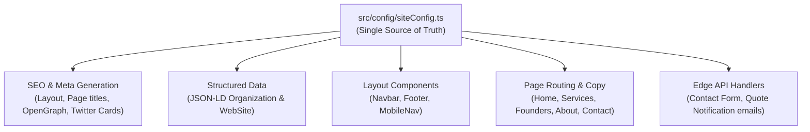

# Technical Architecture & Systems Specification (ARCHITECTURE.md)

## 1. System Overview
The Unixcer Technologies website is built as an enterprise-grade, high-performance web platform utilizing **Next.js (App Router)**, **TypeScript**, **Tailwind CSS**, and **React Three Fiber**.

The platform is designed to run entirely within the **Vercel Hobby (Free Tier)** with zero ongoing hosting or database infrastructure costs, while delivering sub-second load times and a Lighthouse score of 90+.

---

## 2. Single Source of Truth (SSOT) Architecture

### 2.1. Central Configuration Philosophy
A core requirement of this architecture is that **all brand identity, company name strings, contact coordinates, social profiles, founder credentials, services, and project data are decoupled from presentation components**.

All site-wide parameters are defined in a single, strictly typed configuration file:
`src/config/siteConfig.ts` and modular data files in `src/data/`.

### 2.2. Configuration Hierarchy Diagram


### 2.3. Sample `siteConfig.ts` Schema
```ts
export interface SiteConfig {
  name: string;             // "Unixcer Technologies"
  shortName: string;        // "Unixcer"
  legalName: string;        // "Unixcer Technologies"
  tagline: string;          // "Engineering the Intelligent Enterprise"
  description: string;      // Comprehensive SEO meta description
  baseUrl: string;          // process.env.NEXT_PUBLIC_SITE_URL || 'https://unixcertech.vercel.app'
  contact: {
    phonePrimary: string;   // "+91 91754 82748"
    phoneSecondary: string; // "+91 93713 23603"
    email: string;          // "unixcertech.in@gmail.com"
    address: string;        // "Unixcer Technologies, Solapur, Maharashtra, India - 413001"
    whatsappNumber: string; // "919175482748"
    whatsappUrl: string;    // Direct wa.me link with pre-filled message
    calComUrl?: string;     // Free discovery booking link
  };
  socials: {
    github: string;
    linkedin: string;
    twitter?: string;
  };
  navLinks: Array<{ label: string; href: string }>;
  footerLinks: Array<{ label: string; href: string }>;
}
```

If the company name changes, or if a custom domain is attached, **only one line in this file or `.env` needs to be updated**, and every link, meta tag, sitemap URL, footer line, and email template updates automatically.

---

## 3. Directory & Folder Structure

```
Unixcer-Technologies/
├── docs/                                  # Project Documentation
│   ├── PRD.md
│   ├── DESIGN.md
│   ├── ARCHITECTURE.md
│   ├── CONTENT.md
│   ├── TASKS.md
│   └── DEPLOYMENT.md
├── public/                                # Public Static Assets
│   ├── brand/
│   │   ├── logo.svg
│   │   ├── logo-dark.svg
│   │   └── favicon.ico
│   ├── images/                            # Optimized WebP project & service imagery
│   │   ├── projects/
│   │   └── services/
│   └── og-image.png                       # High-resolution 1200x630 OpenGraph card
├── src/
│   ├── app/                               # Next.js App Router
│   │   ├── (legal)/
│   │   │   ├── privacy/page.tsx           # Privacy Policy
│   │   │   └── terms/page.tsx             # Terms of Service
│   │   ├── about/page.tsx                 # About Us & Engineering Culture
│   │   ├── api/
│   │   │   ├── contact/route.ts           # Contact form submission endpoint
│   │   │   └── quote/route.ts             # Project quote submission endpoint
│   │   ├── blog/
│   │   │   ├── page.tsx                   # Engineering Blog catalog
│   │   │   └── [slug]/page.tsx            # Technical Blog posts (MDX/Markdown)
│   │   ├── careers/page.tsx               # Careers & Internship application page
│   │   ├── contact/page.tsx               # Contact & Quote Request page
│   │   ├── founders/page.tsx              # Founders & Leadership (retaining /founders route)
│   │   ├── services/
│   │   │   ├── page.tsx                   # Services catalog
│   │   │   └── [slug]/page.tsx            # Service deep dives
│   │   ├── work/
│   │   │   ├── page.tsx                   # Case Studies & Work portfolio
│   │   │   └── [slug]/page.tsx            # Project case study deep dives
│   │   ├── globals.css                    # Tailwind v4 or v3 base directives & CSS variables
│   │   ├── layout.tsx                     # Root Layout: ThemeProvider, Nav, Footer, JSON-LD
│   │   ├── not-found.tsx                  # Custom 404 page
│   │   ├── page.tsx                       # Home page
│   │   ├── robots.ts                      # Dynamic robots.txt generator
│   │   └── sitemap.ts                     # Dynamic sitemap.xml generator
│   ├── components/
│   │   ├── 3d/
│   │   │   ├── HeroScene.tsx              # R3F Canvas container with fallback
│   │   │   └── NeuralLattice.tsx          # Procedural 3D nodes and geometry
│   │   ├── layout/
│   │   │   ├── Footer.tsx                 # Footer driven by siteConfig
│   │   │   ├── MobileNav.tsx              # Responsive slide-over menu
│   │   │   ├── Navbar.tsx                 # Sticky glassmorphic navbar
│   │   │   └── ThemeToggle.tsx            # System / Dark / Light theme switcher
│   │   ├── sections/
│   │   │   ├── CtaBanner.tsx              # High-conversion closing CTA
│   │   │   ├── FaqSection.tsx             # Accordion FAQ
│   │   │   ├── FeaturedWork.tsx           # Project cards preview
│   │   │   ├── Hero.tsx                   # Interactive hero section
│   │   │   ├── ProcessTimeline.tsx        # 5-step engineering lifecycle
│   │   │   ├── ServicesGrid.tsx           # Bento grid of core services
│   │   │   ├── TechStackMarquee.tsx       # Tech stack marquee strip
│   │   │   └── ValueProposition.tsx       # Key differentiators & capabilities
│   │   └── ui/
│   │       ├── Badge.tsx                  # Monospace tech badges
│   │       ├── Button.tsx                 # Accessible button variants
│   │       ├── Card.tsx                   # Bento card wrapper with hover border glow
│   │       ├── FormFields.tsx             # Accessible inputs, textareas, selects
│   │       └── WhatsAppButton.tsx         # Floating direct chat pill
│   ├── config/
│   │   └── siteConfig.ts                  # Master site configuration & SSOT
│   ├── data/
│   │   ├── blogPosts.ts                   # Structured technical articles
│   │   ├── faqData.ts                     # Comprehensive client FAQs
│   │   ├── foundersData.ts                # Verified leadership bios & skills
│   │   ├── projectsData.ts                # Real case studies (EzTurn, DigiU, SMR)
│   │   └── servicesData.ts                # Deep-dive service definitions
│   ├── lib/
│   │   ├── email.ts                       # Resend API helper
│   │   ├── rateLimit.ts                   # In-memory / edge rate limiter
│   │   ├── seo.ts                         # Metadata & OpenGraph helper
│   │   └── validation.ts                  # Zod schemas for contact/quote forms
│   └── types/
│       └── index.ts                       # TypeScript interfaces and contracts
├── next.config.ts                         # Next.js compiler, headers & CSP config
├── package.json
├── postcss.config.mjs
├── tailwind.config.ts
└── tsconfig.json
```

---

## 4. Rendering Strategy & Data Flow

### 4.1. 100% Static Site Generation (SSG)
Every marketing and informational page is pre-rendered at build time:
- `/`, `/services`, `/about`, `/founders`, `/work`, `/blog`, `/careers`, `/contact`, `/privacy`, `/terms` are rendered statically using Next.js App Router Server Components.
- Dynamic route segments (`/services/[slug]`, `/work/[slug]`, `/blog/[slug]`) implement `generateStaticParams()` to pre-render all static paths at build time.
- **Benefits**: Zero database overhead, instant TTFB (Time To First Byte) from Vercel's global CDN edge network, absolute resilience to traffic spikes, and \$0 server operating costs.

### 4.2. Edge Route Handlers (`/api/contact` & `/api/quote`)
- Handles form submissions asynchronously via Edge/Serverless functions.
- Validates request body with `Zod`.
- Checks rate limits (prevents spam abuse).
- Dispatches transactional email via **Resend** (free tier: 3,000 emails/month).
- Returns structured JSON responses (`{ success: true, message: "..." }`).

---

## 5. Theme Architecture (`next-themes`)

- Configured in `src/app/layout.tsx` using `<ThemeProvider attribute="class" defaultTheme="system" enableSystem>`
- Supported states:
  1. `system` (Default): Automatically tracks user's OS dark/light mode preference with live OS change detection.
  2. `dark`: Forces obsidian theme.
  3. `light`: Forces enterprise daylight slate theme.
- Implements `suppressHydrationWarning` on `<html>` to avoid React hydration mismatches.

---

## 6. Performance Budget & Core Web Vitals

To guarantee **Lighthouse 90+** on mobile and desktop:

| Metric | Target Budget | Optimization Strategy |
| :--- | :--- | :--- |
| **First Contentful Paint (FCP)** | < 1.2s | Critical CSS inlined, zero blocking scripts, font preloading. |
| **Largest Contentful Paint (LCP)** | < 2.0s | Hero copy rendered server-side; hero fallback renders immediately before 3D initializes. |
| **Cumulative Layout Shift (CLS)** | < 0.05 | Explicit `width` and `height` on all image tags and 3D canvas wrappers. |
| **Interaction to Next Paint (INP)** | < 100ms | Lightweight event handlers, minimal main-thread blocking. |
| **Total JavaScript Bundle** | < 160 KB initial | Dynamic imports for Three.js, lucide-react tree-shaking, Framer Motion modular features. |

### 6.1. 3D Canvas Performance Strategy
1. **Dynamic Import**:
   ```tsx
   const Hero3DScene = dynamic(() => import('@/components/3d/HeroScene'), {
     ssr: false,
     loading: () => <HeroFallback />
   });
   ```
2. **DPR Clamping**:
   ```tsx
   <Canvas dpr={[1, 1.5]} gl={{ powerPreference: 'low-power', antialias: true }}>
   ```
3. **Visibility & Scroll Optimization**: Canvas automatically pauses animation when scrolled out of viewport using `IntersectionObserver`.

---

## 7. Security Architecture

Configured via HTTP response headers in `next.config.ts`:
- **Content-Security-Policy (CSP)**: Disallows unauthorized external scripts and iframes.
- **Strict-Transport-Security (HSTS)**: Forces HTTPS with `max-age=63072000; includeSubDomains; preload`.
- **X-Frame-Options**: `DENY` to prevent clickjacking.
- **X-Content-Type-Options**: `nosniff`.
- **Referrer-Policy**: `strict-origin-when-cross-origin`.
- **Permissions-Policy**: Restricts camera, microphone, and geolocation access.

